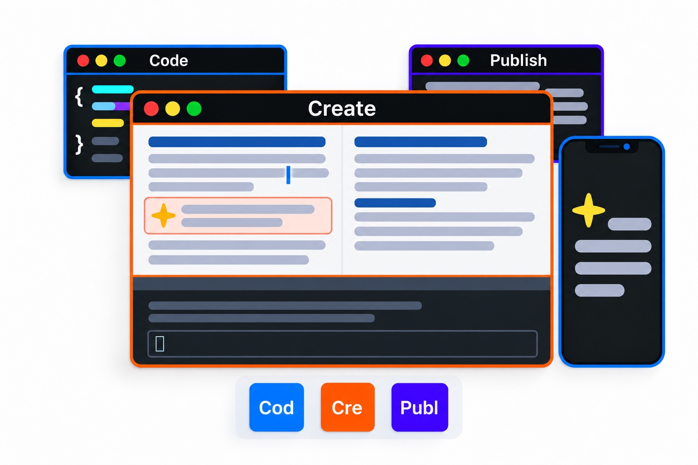

# Rethink the terminal: A portal to AI

Working with AI has fundamentally changed the nature of my work.

My focus is no longer on every detail, but on understanding and steering AI’s work. That calls for reimagining the place where I work with agents, rather than simply extending existing interfaces.

So I have been building and experimenting with AgentTerm since January. It has become my portal to AI: shaping an idea, turning it into working code, and revisiting the work later ([demo](https://github.com/albertwujj/agent-term#demo)). These notes share the thinking behind its design.

## Rethinking the terminal

### [Why I give each lead agent its own OS window and icon](https://yunxin.github.io/rethink-terminal/own-os-window/)

Agents show up when needed.

### [Why I run AgentTerm from source](https://yunxin.github.io/rethink-terminal/run-from-source/)

Works like an installed app. Personalize it without the friction.

### [Why documents, code and images open right in the agent’s terminal window](https://yunxin.github.io/rethink-terminal/files-in-terminal/)

I can edit the rendered content to propose changes; my agent refines it and replies in place.

### [Building on the terminal’s text interface](https://yunxin.github.io/rethink-terminal/plain-text-interface/)

AgentTerm understands agents; agents understand AgentTerm.

## Building on the terminal

### [Curated code review: explanations grounded in code](https://yunxin.github.io/rethink-terminal/curated-review/)

I removed a check so we focus on what needs my judgment.

### [A hub for agents across machines, with phone and voice access](https://yunxin.github.io/rethink-terminal/hub-across-machines/)

AgentTerm annotates transcribed speech, and my agents correct garbled text using the context of our work.

---

AgentTerm has other features and design choices not covered above, such as [commenting on agent output](https://github.com/albertwujj/agent-term/blob/main/docs/comment.md), [copying it without reformatting](https://github.com/albertwujj/agent-term/blob/main/docs/copy.md), [connecting to an IDE](https://github.com/albertwujj/agent-term/blob/main/docs/ide.md), [running long jobs](https://github.com/albertwujj/agent-term/blob/main/docs/jobs.md), [coordinating a shared workspace](https://github.com/albertwujj/agent-term/blob/main/docs/lock.md), and [setting up and invoking guides across AI CLIs using a namespace convention based on folder paths](https://github.com/albertwujj/agent-term/blob/main/docs/conventions.md#guides-across-cli-vendors).

Use [AgentTerm](https://github.com/albertwujj/agent-term#agentterm) as is, or adapt it to your work.
