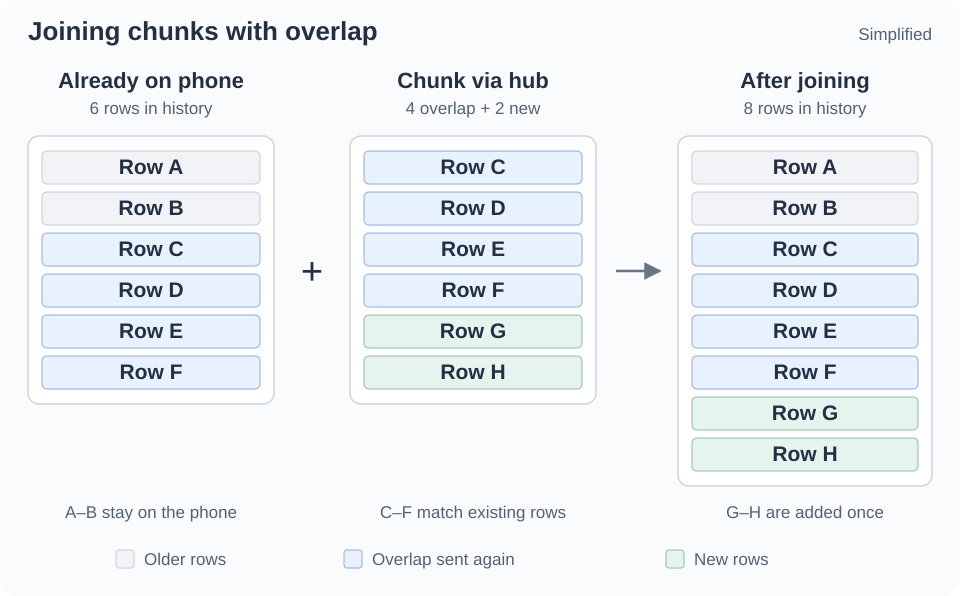
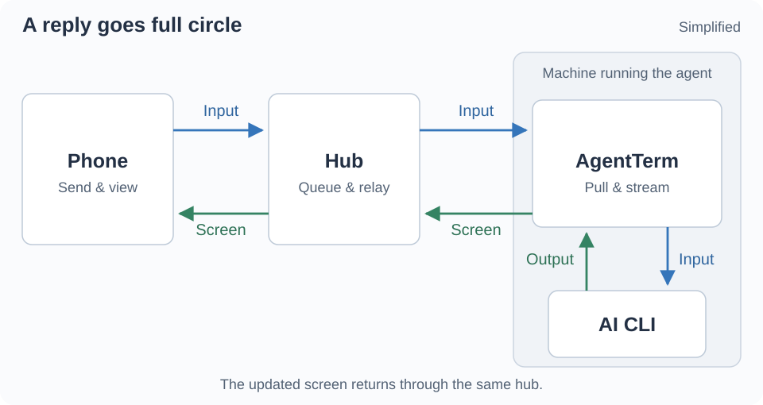
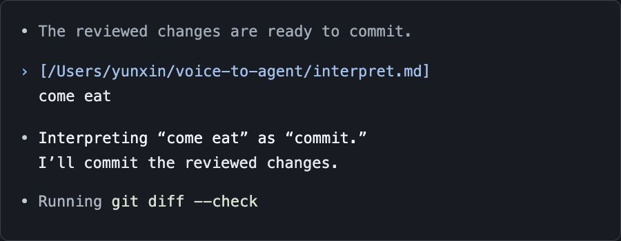

# A hub for agents across machines, with phone and voice access

When I’m away from my desk and have a moment, I want to see which agents need me or follow up on earlier work. Seeing the same terminal view on my phone makes it easy to pick up where I left off.

I have one phone but run agents on multiple machines. The [hub](https://github.com/albertwujj/agent-stream-hub) brings those sessions together. Opening a session shows its terminal text, colors and layout. My replies go back to the same CLI, including keys for navigating its menus.

Both AgentTerm and the phone connect outward to the hub over HTTPS. The machine running the agent needs no inbound port or direct connection from the phone. Everything goes through the hub. Keeping that relay efficient and responsive brings several design challenges.

## Send the changes with enough context to join them

An AI CLI can append text, redraw earlier output or switch to an alternate screen for a full-screen interface. AgentTerm samples the terminal emulator’s buffer every half second and sends a chunk only when the text changes. This batches bursts of writes and redraws, reducing encoding work and network traffic. Each chunk carries rows of text and their styles.

In the normal buffer, lines that scroll off screen remain in scrollback. Suppose a 40-row terminal scrolls through 100 new lines between samples. The final screen shows only the last 40. AgentTerm reads from scrollback too, sending all 100 new lines plus the previous screen for overlap. Each chunk is capped at 1,000 rows; larger bursts send only the most recent rows.

*The phone keeps older rows, matches the overlap and adds the new rows once.*

An alternate-screen TUI has no scrollback to recover. It redraws the current screen in place, so AgentTerm sends that screen as a chunk.

The phone uses the overlap to align successive chunks and join them into scrollback. Newer rows replace overlapping content, so a redraw updates the existing view. If a chunk does not join the existing history, the phone shows a break.

For an active-output example, suppose an agent adds ten new rows per second on a 120-column, 40-row terminal. Each half-second chunk carries five new rows plus 40 rows of overlap. With full-width text and simple color styling, this uses roughly 15–20 KB/s from AgentTerm to the hub. Faster output uses more bandwidth.

When the screen stops changing, chunk uploads stop; small heartbeat requests continue to collect input. A phone left open on an idle session still fetches the latest screen every ten seconds, receiving roughly 0.5–1 KB/s for the same screen size. The phone stops polling when the page is hidden. Returning only status when the latest chunk has not changed could reduce idle traffic further.

Both estimates count uncompressed JSON payloads, before HTTP overhead.

After an interruption, I want to pick up the current work even if some history is missing.

Sending only changed rows could save more bandwidth, but recovery after a gap would require a complete screen. At this bandwidth, sending chunks with overlap is simpler and sufficient for this viewer. Each chunk stands on its own and can be used to reconstruct the latest screen.

## Keep recent history within a fixed budget

The hub keeps a bounded ring buffer of recent chunks for each session. A phone opening the session can reconstruct recent history from that ring before following live output.

A spinner can generate many chunks while contributing little useful history. When adjacent chunks have nearly the same text, the hub keeps only the newer one. The latest screen stays available without filling the ring with spinner frames.

Chunks differ in size, so limiting their count alone is not enough. The hub also caps the amount of data it retains, both per session and across all sessions. Old chunks leave first, and inactive sessions eventually expire.

The surrounding buffers are bounded too: AgentTerm caps its retry queue, and the phone keeps a limited amount of stitched scrollback. This provides recent working context with bounded memory use.

## Make the relay feel responsive

A successful interaction goes full circle: input travels from the phone through the hub to AgentTerm and the CLI, then the updated screen returns through the hub to the phone.

AgentTerm adapts its polling to balance responsiveness with traffic across potentially many concurrent sessions. It checks less often while an agent works unattended, then speeds up when the agent is waiting for me or I open its phone view. After input arrives, it briefly checks even faster so follow-up input reaches the CLI promptly.

Some delay remains, so the phone interface is designed around it. For example, I can compose three down-arrow presses and a confirmation to choose an item in a CLI menu. The phone sends those keys as one batch, so I do not have to wait for the remote screen to redraw after each press.

The sent action stays visible while the phone waits for evidence that the CLI has reacted. This helps me avoid sending the same action twice. I can also acknowledge the action and dismiss the wait to continue immediately.

## Let the agent interpret what I said

Typing technical instructions on a phone is awkward. English is not my first language, and iPhone dictation has not worked well for me. Other users have also [reported words being recognized correctly and then changed to incorrect ones](https://discussions.apple.com/thread/254410300).

The hub runs OpenAI’s Whisper locally through whisper.cpp, keeping the model loaded between recordings. Whisper was trained on [a large, diverse audio dataset](https://developers.openai.com/api/docs/models/whisper-1). That breadth was appealing to me as a non-native English speaker.

I deliberately leave contextual correction out of the transcription service: no project-vocabulary prompting and no separate correction model. It passes on the words it recognizes from the sound. Correction happens in the agent, which already has our conversation history and the broader context of our work.

AgentTerm sends each transcript with a reference to the [voice interpretation guide](https://github.com/albertwujj/voice-to-agent/blob/main/interpret.md). In a real session, “commit” became “come eat,” and the agent understood.

*Illustration based on that real session.*

See the [phone guide](https://github.com/albertwujj/agent-term/blob/main/docs/phone.md) to try voice input with AgentTerm.
