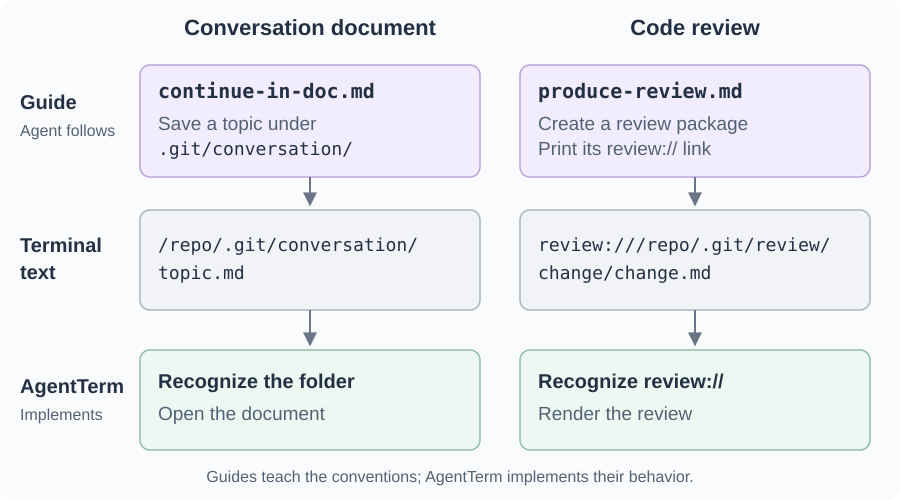
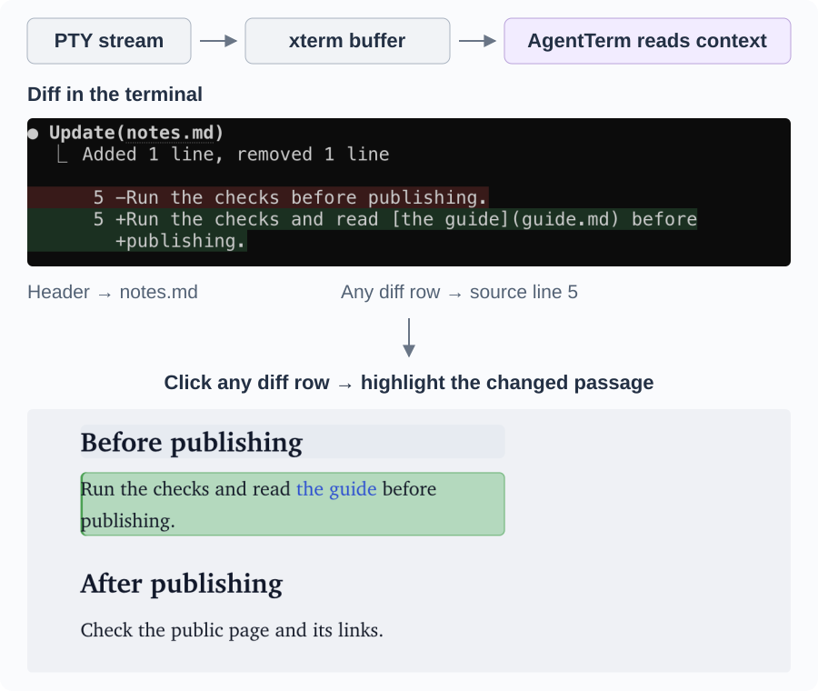

# Building on the terminal’s text interface

## Rich patterns in the output

An agent’s output is full of useful structure: **filenames**, **line ranges**, **symbols**, **quoted code**, **diffs** and **links**. AgentTerm recognizes these patterns and turns them into ways to inspect the work and respond.

The relationships between lines are useful too. An agent may name a file above a code or diff block, then discuss individual lines or functions below it. AgentTerm uses that filename as context: I can click a code line or symbol and jump to the relevant place in my IDE, even when the path is not repeated beside it.

A document path connects the conversation to a rendered page where the agent and I can refine the content together. The [previous essay](files-in-terminal.md) explores that workflow. Recognizing patterns in the text gives us entry points to richer interactions around the agent’s work.

An agent may print `README.md` when several files share that name. AgentTerm orders the matching files using context and heuristics, making it easy for me to pick one. The IDE integration similarly offers a chooser when navigation finds multiple targets.

In my daily use, these interpretations usually get me where I want to go, saving repeated searches and app switches. There is still room to recognize more patterns and relationships. For the most valuable workflows, however, guides help agents use clearer, more consistent formats, as described in the next section.

## Guides establish new, deliberate patterns

Guides teach agents conventions that AgentTerm recognizes. In both examples below, AgentTerm and the agent start to interact through ordinary terminal text.

For the protocol details, see the [document workflow](files-in-terminal.md#technical-notes-two-partners-working-at-once) and [review workflow](curated-review.md#a-small-package-with-code-supplied-by-git).

More workflow types can be added using the same pattern.

## Technical challenges: interpreting terminal streams in context

The user’s prompt text flows through the terminal and a PTY to the CLI. The CLI’s output flows back through the PTY to the terminal. AgentTerm reads those streams directly for some tasks and uses the screen buffer built from the output for others.

An AI CLI can move the cursor, erase text and redraw earlier output. The terminal emulator, xterm, interprets those control sequences and maintains a buffer of the screen and scrollback. AgentTerm uses that buffer to connect a click to the file and passage it refers to.

### An example: interpreting a diff in context

Click a diff row to open the Markdown document at that passage and **highlight the change**. Similarly, a source-code diff takes me to the IDE. That small interaction needs several kinds of interpretation.

Here, a **row** is a row on screen; a **source line** is a line in the file. The added sentence below occupies two rows.

*Clicking a diff row highlights the changed passage in the rendered view.*

AgentTerm addresses three challenges:

- **Reconstruct the line.** A long source line can occupy several screen rows. xterm can wrap it to fit the terminal, and a CLI can insert its own breaks, repeating a marker or indentation. AgentTerm analyzes these cues to associate each continuation row with its source line.
- **Find the enclosing file.** The diff rows carry the changed text; the filename is printed above them. AgentTerm looks above the diff body for the header naming `notes.md`.
- **Land in the current content.** A deleted row refers to text that is gone from the file. AgentTerm maps it to the next surviving line in the diff, then uses the line number and source text to locate the rendered passage.

### The stream and the screen

The stream and the screen give different views of the interaction. A TUI can send the same text repeatedly to repaint the screen, then erase it from view. Treating each repeated link as a new request could reopen a viewer at the wrong time. Looking only at the current screen could lose a link that was printed earlier.

AgentTerm uses both views, combining them where needed to interpret what happened. It retains recent document links from the stream and checks the screen buffer to distinguish a newly printed review link from a repaint.

On the input side, a submitted prompt can contain text I never typed. I might type `@gu` and choose `@docs/guide.md` from the CLI’s completion menu. The completed path comes back as output. AgentTerm combines the typed input with the completed reference on that input row, preserving the full filename in the prompt history so I can find the session by it later.

## Turn detection through the terminal interface

AgentTerm **estimates whose turn it is** to drive the working indicators on each session’s Dock tile or taskbar button. It also sends that estimate to the hub, which shows which agents need me across machines.

Terminal output includes the agent’s work, idle prompt redraws and echoes of my typing. Some CLIs also report that they are ready or waiting for input through title updates. AgentTerm analyzes these signals alongside my typing and prompt submissions to estimate whose turn it is.

Hooks already offer explicit lifecycle events in [Claude Code](https://code.claude.com/docs/en/hooks), [Codex](https://learn.chatgpt.com/docs/hooks) and [Cursor CLI](https://cursor.com/changelog/cli-jan-16-2026).

My choice so far has been to minimize vendor-specific integration code by starting with the terminal streams AgentTerm already handles. Most code and tests stay shared. I can evaluate vendor-specific integrations later.

## Take the interface beyond this machine

[The hub](hub-across-machines.md) carries this further: I can open the same terminal screen from my phone, recognize where I left off and respond there.
